# 👋 Hi, I'm Lucas Kojo

### TypeScript-First Full-Stack & Mobile Developer | Data Science Enthusiast

I'm a developer and Data Science & Analytics student at **Jomo Kenyatta University of Agriculture and Technology (JKUAT)**. I enjoy building modern web and mobile applications, designing maintainable application architectures, and exploring how data and AI can solve practical problems.

My approach to software development is **TypeScript-first, with a strong emphasis on type safety and reliable software design**. I use TypeScript as my primary language not simply because I enjoy it, but because its type system helps make application code more predictable, define clear contracts between system components, catch many errors during development, and make larger codebases easier to maintain and refactor. I work across frontend, backend, and mobile applications, with a particular interest in end-to-end type safety, reusable monorepo architecture, authentication, data synchronization, and reliable background processing.

- 💻 Building full-stack applications with TypeScript, React, TanStack, Bun, and ElysiaJS.
- 📱 Developing cross-platform mobile applications with Expo and React Native.
- 🧱 Exploring scalable monorepos, shared packages, and end-to-end type-safe APIs.
- 🤖 Interested in Data Science, Machine Learning, and practical AI integrations.
- 🔐 Interested in application security and secure software engineering.

---

## ⚙️ Technology Stack

The sections below distinguish the tools I currently use from technologies I've worked with previously. The current stack reflects tools found in recent project manifests as well as technologies I actively work with.

### 🚀 Currently Using

#### Language

  

**TypeScript** is my primary language across web, backend, and mobile development. I value it as an engineering tool for expressing clear contracts, catching type-related mistakes early, improving refactoring confidence, and building maintainable systems. Type safety is a key goal; runtime validation, testing, and security checks remain essential because TypeScript types are erased at runtime.

#### Frontend & TanStack Ecosystem

  
  
  
  
  
  
  

- **TanStack:** Start, Router, Query, Form, Table, Virtual, and related developer tools
- **React** and **Tailwind CSS**
- **shadcn/ui**, Radix UI, and Lucide
- **Vite**

#### Backend & API Development

  
  
  

- **Bun** – runtime, package manager, and workspace tooling
- **ElysiaJS** – backend APIs and server applications
- REST APIs and modular service-oriented application architecture

#### API Clients & End-to-End Type Safety

  

- **Eden Treaty** – type-safe client for consuming ElysiaJS APIs, with request and response types inferred from backend route definitions
- Shared API contracts between frontend, backend, and mobile applications

#### Mobile Development

  
  
  

- **React Native**
- **Expo** and Expo Router
- **NativeWind**

#### Databases & Data Access

  
  
  
  
  

- **Drizzle ORM** and Drizzle Kit
- **Neon** – serverless PostgreSQL
- **Turso / libSQL** – SQLite-based database platform
- **PostgreSQL** and **SQLite**

I choose the database based on each project's requirements rather than forcing every application onto one database platform.

#### Authentication & Application Security

  
  
  

- **Better Auth**
- OAuth and social sign-in
- Passkeys and two-factor authentication
- Session management and role-based access control
- Secure API and application design

#### Caching, Queues & Background Processing

  
  
  

- **Upstash Redis** – caching and rate limiting
- **Upstash QStash** – messaging and background task delivery
- Asynchronous and scheduled workflows

#### Cloud Services, Integrations & Observability

  
  
  
  
  

- **Brevo** – transactional email and email delivery
- **Cloudinary** – media uploads and asset management
- **Sentry** – error tracking and application monitoring
- **Firecrawl** – web data extraction
- **AI SDK / OpenRouter** – AI-powered application features

#### Monorepos, Tooling & Developer Experience

  
  
  
  
  
  
  

- **Bun Workspaces**
- **Turborepo**
- Shared TypeScript packages and workspace-based architecture
- Git and GitHub
- Docker and Linux

#### Data Science & Machine Learning

  
  
  
  
  
  
  
  
  

- Python, Pandas, and NumPy
- Scikit-learn and TensorFlow
- Matplotlib, Seaborn, and Jupyter Notebook
- Microsoft Excel and Power BI

---

### 🕰️ Previously Used Technologies

These technologies helped build my foundations in programming and web development. They are part of my experience, but are not the primary tools in my current projects.

  
  
  
  
  
  
  
  
  
  
  

- **Languages:** JavaScript, PHP, C, C++, and Java
- **Frontend:** HTML, CSS, and Bootstrap
- **Backend:** Node.js and Express.js
- **Databases:** MongoDB and MySQL
- **Stack:** MERN (MongoDB, Express.js, React, and Node.js)

---

## 🏗️ Engineering Interests

I enjoy exploring the engineering decisions behind reliable, maintainable applications, including:

- **Monorepo architecture:** Organizing web, mobile, API, and shared packages with Bun Workspaces and Turborepo.
- **End-to-end type safety:** Sharing types, schemas, and API contracts across application boundaries.
- **Backend architecture:** Designing modular APIs, service layers, authentication, and authorization.
- **Offline-first applications:** Local data, synchronization, and resilient user experiences.
- **Background processing:** Queues, scheduled jobs, caching, and asynchronous workflows.
- **Application security:** Secure sessions, access control, API protection, and security best practices.
- **AI-enabled applications:** Integrating language models and data extraction into useful products.

---

## 🚧 Selected Projects

These projects demonstrate my work across full-stack web development, mobile engineering, and practical AI integrations. Some source repositories are private, but the live applications below are available to explore.

### [Juriclad Group](https://juricladgroup.org/) — Legal Intelligence & Research Platform

Juriclad Group is an independent legal intelligence and research platform built to serve legal students and the wider legal community with legal information, research resources, and publications.

I developed the website with a public-facing experience and a protected member area for contributing content.

- **Public website:** Built approximately eight public-facing routes presenting the platform, its information, and its resources.
- **Dynamic content pages:** Implemented detail pages for individual articles, team members, and other content, with approximately two to three dynamic route patterns.
- **Protected member area:** Implemented authenticated routes that allow members to add articles and publish other materials.
- **Content publishing workflow:** Supports both public consumption of published material and member contribution through protected functionality.
- **Current implementation:** Built with a Bun and Express.js backend and a React, TypeScript, and Tailwind CSS frontend.

**Technologies:** Bun, Express.js, TypeScript, React, Tailwind CSS.

**Live website:** [juricladgroup.org](https://juricladgroup.org/)

**Planned improvement:** I am planning to rewrite the platform using my current TypeScript stack, with TanStack Start as the full-stack React framework. This is a planned modernization, not the technology stack of the currently deployed website.

### [Recall](https://recall-lk.vercel.app/) — AI-Powered Knowledge & Bookmark Manager

Recall is a web application for turning web links into an organized personal knowledge library. It allows users to save online resources, extract and process their content, and make that information easier to revisit through AI-generated summaries and organization.

- **Web content extraction:** Uses Firecrawl to retrieve and process content from saved URLs.
- **AI-powered summaries:** Integrates language-model capabilities to generate concise summaries of saved resources.
- **Organized knowledge library:** Helps users keep saved content and its extracted information organized for later reference.
- **Authentication and persistence:** Uses Better Auth for authentication and Drizzle ORM with Turso/libSQL for data storage.
- **Modern full-stack experience:** Built with TanStack Start and TypeScript, with AI features integrated through the AI SDK and OpenRouter.

**Technologies:** TypeScript, React, TanStack Start, Better Auth, Drizzle ORM, Turso/libSQL, Firecrawl, AI SDK, OpenRouter.

**Live application:** [recall-lk.vercel.app](https://recall-lk.vercel.app/)

### [Nexus](https://github.com/lucaskojo02/Nexus) — Social Networking Platform

Nexus is an X-inspired social networking application built with a TypeScript-first monorepo architecture. It combines a cross-platform mobile client with a Bun-powered backend, bringing together social interactions, asynchronous workflows, notifications, and engagement analytics.

- **Social interactions:** Implemented post creation, editing and deletion, likes, comments, replies, following, and related social features.
- **Optimistic UI:** Used TanStack Query mutation lifecycles to update the interface immediately for actions such as creating, liking, unliking, and deleting posts, with cache rollback when mutations fail.
- **Background job processing:** Built an outbox-based notification pipeline with Upstash QStash, scheduled processing, retry handling, and dead-letter queue callbacks.
- **Notification system:** Implemented notifications for new posts from followed users, follows, post likes, profile views, and comment/reply activity.
- **Engagement analytics:** Built profile-view and post-view tracking, including unique-viewer metrics, audience breakdowns, and time-based analytics.
- **Observability:** Integrated Sentry across the Bun backend and React Native application for error and performance monitoring.
- **Real-time messaging:** Direct and group messaging using ElysiaJS WebSockets is currently in development.

**Technologies:** TypeScript, Bun, Bun Workspaces, Turborepo, ElysiaJS, React Native, Expo, Expo Router, TanStack Query, Eden Treaty, Better Auth, Drizzle ORM, Turso, Upstash QStash, Sentry, NativeWind.

**Repository:** [github.com/lucaskojo02/Nexus](https://github.com/lucaskojo02/Nexus) (private repository; access required)

**Status:** In development. Messaging is an ongoing feature.

### StoreManager / ShopStack — Product & Inventory Management

A product and inventory management project exploring modern full-stack application development, database-backed workflows, media management, and reliable application architecture.

**Technologies:** TanStack Start, TypeScript, Drizzle ORM, PostgreSQL, Cloudinary, Sentry.

---

## 📊 GitHub Statistics

  
  

  

These cards are generated and committed to this repository daily with GitHub Actions, rather than being served by a shared public image endpoint. You can also explore my [GitHub profile](https://github.com/lucaskojo02).

---

## 🌍 Let's Connect

I'm always happy to connect with developers, exchange ideas, and collaborate on interesting projects.

  
  
  

---

  <i>Building thoughtful software, learning continuously, and evolving through code.</i>

